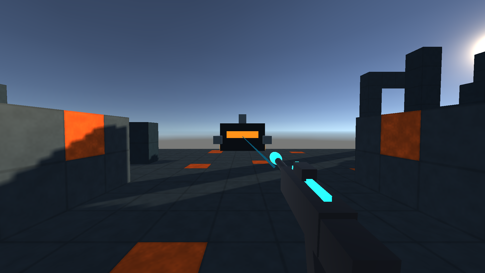

# Construction safety — 0.120.0

Placement now refuses space occupied by the suit, a living unit or the live relay
before charging resources. Looking down can no longer build a wall through the
suit's feet; a shoulder/head extending into an adjacent voxel also blocks it.
This fixes a reproduced safety defect in the gather → build → survive loop.
Studio-quality encounter, native play and fun acceptance remain open.

## Contract and implementation

`BuildResult.Occupied` is appended, preserving existing enum values. World.Build
checks the live player grid cell, living enemy/squad cells and live relay cell.
Simulation's common aimed builder additionally checks the continuous FPS body's
complete voxel footprint. Movement collision and this check use the same body
bounds, including the existing top epsilon. Movement behavior itself is unchanged.

All nine aimed builders use this guard. Existing costs, support, terrain, aim,
gathering and timing remain unchanged. Refusal does not modify the world,
inventory, counters or save state. Defeated units/disabled relay do not reserve
cells forever. PlayerFeedback says `BUILD SPACE OCCUPIED · AIM ELSEWHERE` and
plays the original refusal signal. No save schema migration or extra Simulation.
An older save that already contains an overlapping block is not rewritten.

## Evidence

Before the fix the new intended-behavior tests produced **5166 pass / 10 fail**:
the aimed self-overlap and all four occupied grid cases succeeded and spent
resources. The prior 5165 checks remained green. The fix and boundary checks now
produce **5181 pass / 0 fail**, Release build **0 warnings/errors**, on genuine
.NET 8.0.33. No existing expectation or fixture was changed. Tests cover exact
state retention, fractional head/shoulder overlap, body/floor/ceiling distinction,
occupied suit/warden/squad/relay, clear placement and defeated-cell reuse.

Commands: Release build of tests/Forgeborne.Core.Tests/Forgeborne.Core.Tests.csproj
with --no-restore; isolated .NET 8 execution of its Release DLL; then
tools/build-unity-core.ps1. All nine netstandard2.1 DLLs were installed. Core hash:
`03d9e46df492fd7276138a8baebc1e5738f3e29ab08d9b7316e2b19b79c0b262`.
The dynamic Core-source no-drift guard passes.

Fresh started/paused Main ran `tools/unity-construction-smoke.cs` through the
actual adapter build helper: suit/warden refusal and message, exact unchanged
JSON, clear supported placement, actual two-stone payment and retained one
Simulation/zero time. Finally restored the original full save in place.
`tools/unity-feedback-smoke.cs` and `tools/unity-orbital-smoke.cs` passed again.
Scoped pre-build Unity console returned zero warning/error entries.

`tools/unity-action-render.cs` used the same Main Simulation for a paused shot
fixture, invoked the actual fire/actor/weapon presentation, captured the real
FPS camera at 1920×1080 and restored full state/pose. Screen-overlay UI is
excluded. The image verifies visible original pulse/model/material output,
without claiming normal keyboard play, audible quality or final art:

The primitive weapon/actor models, sparse environment and flat horizon remain
visible quality gaps. This image is evidence to assess those gaps, not final art.

## Delivery boundaries

Ordinary **0.120 Windows x64/Mono packaging passed**: None, **0 errors/warnings,
101,865,611 reported bytes, 41.10 seconds**, output
ForgeborneUnity/Builds/Windows-QA/20261101T113541Z/Forgeborne.exe. Packaged Core and
Windows bridge match installed DLLs. The [build report and artifact hashes](evidence/2026-11-01/windows-0120-build.json)
are retained. The executable was not launched. URP's post-build inventory message
has the previously documented MCP classification difference; it is not suppressed.
Native keyboard/mouse, listening, sustained representative 1440p profiling and
Rob's quality/fun review remain open. Windows automation could not activate Unity
after fresh selection/retry; Rob is away from the PC. No security UI was operated.
Continue independent work without asking him repeatedly to dismiss a prompt.

Changed paths: Core FpsController/Simulation/World; construction tests/runner;
Unity Core DLL, PlayerFeedback and version; production smoke/render tools, render
evidence and synchronized checkpoint/current-work/README/changelog.
Rollback point: local 0.119 commit `7a3fdca`; use a reviewed revert and preserve
work. No push, main/visibility/licence mutation or publication occurred.

Section 0 for the full goal: 1 FAIL (full studio-quality loop), 2 PASS,
3 PASS for scoped verification, 4 FAIL (native/player acceptance open), 5 PASS,
6 PASS, 7 FAIL (representative performance), 8 PASS, 9 PASS for the local package,
10 PASS, 11 PASS with recorded Unity build variance, 12 PASS (original code/art),
13 N/A (no delegated agents), 14 PASS, 15 PASS.

Self-audit: the previously successful unsafe placements now fail before spending,
and the production path confirms both refusal and valid placement. Shared body
bounds retain collision behavior; the prior regression suite is unchanged.
Rendered output remains visibly prototype quality. The full game is unfinished.

Frozen Constitution 6.18.0 SHA `63d99cdc72a1c18b5aa91b9336d02fd30126407b`.
Skill evolution: elapsed-time/callback verification, separate `922dcbb`,
**staged, not propagated**; the continuation starts no new obligation.
