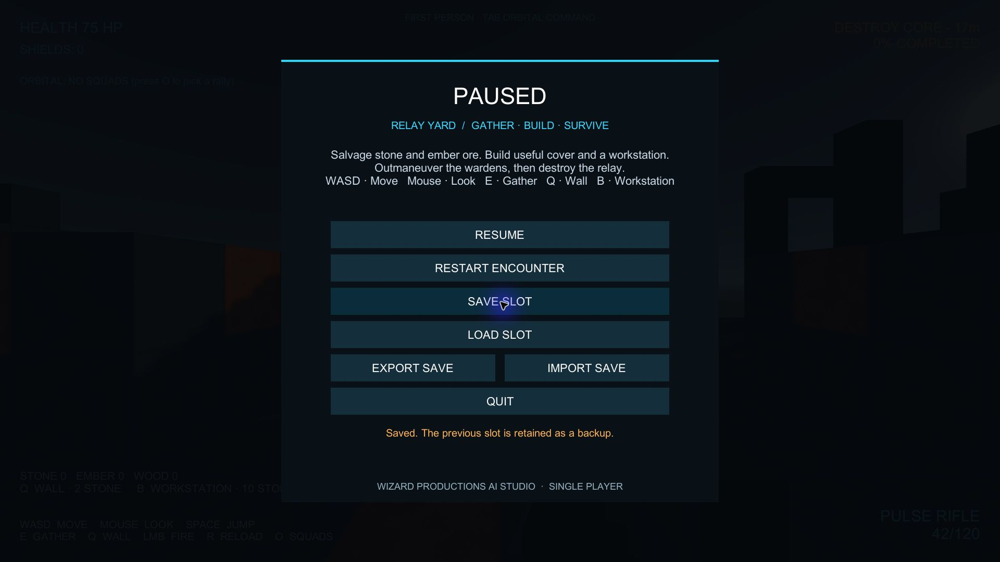

# Native player flow — 0.120 follow-up

The ordinary Windows x64/Mono player at Builds/Windows-QA/20261101T113541Z now
has direct native UI evidence. Rob returned home; fresh Windows selection and
activation worked. No security prompt was present in the observed player flow,
and no security permission/setting was operated. The earlier activation failure
is no longer the current blocker.

Observed at 1920×1080 through actual Windows input:

- Launched the verified executable and clicked ENTER THE COURTYARD. FPS, HUD,
  actors and resources rendered. Tab switched to perspective orbital command.
  Combat pressure continued; shields/health fell. Escape paused/released pointer.
- SAVE SLOT succeeded; its backup matched the prior slot hash. The first
  RESTART ENCOUNTER click showed confirmation; the second restored 100 HP/85
  shields and the wave. Escape paused again. LOAD SLOT restored the saved
  encounter. Re-saving matched the original native save SHA-256 exactly.
- QUIT exited. After verified process/window exit, a cold launch returned to
  entry. LOAD SLOT restored the same damaged encounter. Saving again produced
  exactly the same SHA-256. Final QUIT exited normally.

Native saved state: Seed 42, tick 22, health 75, shields 0, three enemies, feet
(16,4,16), grounded, yaw/pitch 0, fractional clock remainder
0.0031575513382754265 and movement phase 2. Complete save SHA-256:
`70313c49d9d8e160bb055374c83c813c3789ac8ddb295e39af9009d3c8929ad0`.
The comparison covers the full serialized save, not only visible HUD values.

This raw Windows capture was archived for delivery evidence, without image
editing/redraw. Full QA save/original backups stay outside Git in
C:/Users/Bulkl/.codex/artifacts/forgeborne-2026-11-01/native-0120-saves-before.
After final process exit, both original slot files were restored and verified
against their original hashes. No user save changes were left.

The final fresh Player.log scan had no matches for Exception, Error, Failed,
WARNING or Shader error. This is a scoped scan, not proof of every runtime path.
Package identity: [windows-0120-build.json](evidence/2026-11-01/windows-0120-build.json).
Computer-use skill, node_repl + @oai/sky, provided all keyboard/click operations
from fresh returned target observations. No game source changed for this follow-up.

Full native gather → build → survive, positive gathering/placement/firing, all
orbital cursor commands, mouse feel, audible mix, 1440p profiling and Rob's quality/
fun acceptance remain open. Models/environment/animation need substantial work.
Uncommitted construction preview work is separate from this tested 0.120 package.

Section 0 for the full goal: 1 FAIL, 2 PASS, 3 PASS for scoped checks, 4 FAIL for
incomplete whole-loop acceptance, 5 PASS, 6 PASS, 7 FAIL (performance), 8 PASS,
9 PASS, 10 PASS, 11 PASS with documented Unity build variance, 12 PASS, 13 N/A,
14 PASS, 15 PASS. Self-audit: native process/input replace packaging-only evidence
for these paths; full-byte cold restoration and prior-slot recovery passed.
Broader interaction/content/performance/fun gates remain open. Nothing was pushed.

Frozen Constitution 6.18.0 accepted SHA
63d99cdc72a1c18b5aa91b9336d02fd30126407b. Skill evolution unchanged:
elapsed-time/callback verification, separate 922dcbb, staged/not propagated.
