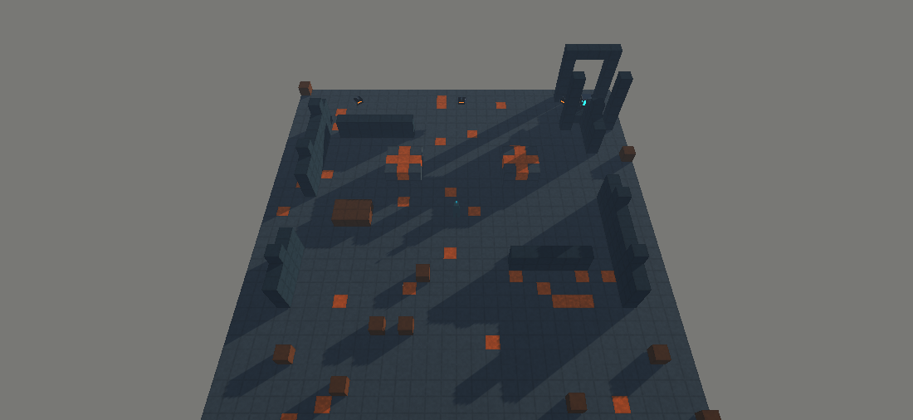

# Perspective orbital camera checkpoint — 0.118.0

The saved Main scene now has an original perspective command camera wired to its
existing GameManager and FPS adapter. This is a scoped pre-production contribution;
keyboard interaction, sustained live command play and full native verification
remain open. Studio quality and fun are not accepted.

## Behavior

Tab switches views. Orbital controls are WASD pan, wheel zoom, Q/E rotate and F
focus on the suit. The existing O / 1–7 / Enter / Escape deployment flow and K/X
re-rally/dismiss selection use the command camera's cursor ray. FPS input retains
the original crosshair ray. Command selection has enough reach for the elevated
camera; FPS reach is unchanged. No Cinemachine or new gameplay package is added.

The view is perspective at 55 degrees, with a bounded horizontal focus and zoom.
It is a 3D view of the same live world. It never changes time scale or creates/
advances a Simulation. FpsInputAdapter remains enabled and owns positive frame
advancement in either mode. In command mode it submits zero player movement/look
and suppresses FPS gathering/building/fire; the physical suit remains exposed.
Normal entry/pause/terminal menus still own pause. Input remains legacy/Both.

Exactly one game camera is enabled/tagged MainCamera. The pointer is free in
command mode, including after menu resume. FPS gun, crosshair and FPS instructions
hide; an original suit view follows canonical feet position and yaw with no extra
collider. Materials/models are owned and released. Switching views cancels free
pending commands without spending resources. Loading a different world refocuses
the camera; presentation mode/zoom are session state, separate from saved rules.

## Verified evidence

Core remained unchanged; the existing Release suite was rerun on genuine
.NET 8.0.33: **5155 passed, 0 failed**, including the dynamic no-drift guard.
The Unity compile/scoped final console query returned **0 errors/warnings**.
Source confirms no new Simulation or time advancement in OrbitalCameraRig.
Both input (`activeInputHandler: 2`) and the legacy scroll-wheel axis were checked.

Actual Unity MCP added/saved the rig in Main and verified its references to the
existing manager/FPS camera/input/reticle/controls, with FPS initially enabled and
orbital initially disabled. `tools/unity-orbital-smoke.cs` then ran in a fresh,
started, paused Main. It passed both view switches, perspective/MainCamera tag
selection, free pointer, hidden FPS-only views, suit pose, absence of suit
colliders, overhead pose and exact serialized-state/controller/Simulation identity
preservation. The sole FPS frame driver stayed enabled. These are scripted live
component checks; they are not claimed as keyboard or elapsed-time play evidence.

Unity MCP rendered the actual orbital camera at 1100 x 506, position
`(16.00, 33.57, -4.08)`. Camera-only capture excludes screen-overlay UI. This
shows prototype geometry/materials and is not a final art/animation acceptance:

The supplied production brief's full vision remains in design-pillars.md.
Rob directs the product; this checkpoint does not imply architectural/fun approval.

## Native packaging follow-up and limits

The ordinary **0.117.0** Windows x64/Mono build subsequently succeeded in 83.13 s:
**0 errors, 0 warnings, 101,777,147 reported bytes**, options `None`, output
`ForgeborneUnity/Builds/Windows-QA/20261101T080710Z/Forgeborne.exe` (ignored/local).
It is distinct from the cancelled empty request and the earlier development build.
MCP scheduled the verified build helper on Editor update while Windows held delayed
callbacks; no security UI was operated. The build utility now uses that scheduling
path and rejects concurrent/queued build requests. A guard correctly refused a
later redundant direct attempt after the completed output was no longer empty.

The old Windows Firewall prompt still needs manual dismissal before native input
QA. No network permission was granted. Native play/transfer/performance are not
established by packaging or the development entry menu. The 0.117 executable also
does not contain this newer camera work. Subsequent ordinary 0.118 packaging
passed: 0 errors/warnings, 101,783,851 reported bytes, 21.35 seconds, output
ForgeborneUnity/Builds/Windows-QA/20261101T084917Z. Native play remains unverified.
The later 0.119 feedback package also includes the camera; see
[action-feedback-checkpoint.md](action-feedback-checkpoint.md).

Still required: actual Tab/pan/zoom/rotate/focus and cursor deployment/re-rally/
dismiss input, unchanged real-time world cadence while commanding, pause/resume,
death/load camera recovery, native FPS/orbital/save flow and sustained representative
1440p profiling. Full encounter/gather/build/combat feedback, original audio,
final art/animation and director quality/fun review remain active work.

## Elapsed-time follow-up on 0.120

`tools/unity-orbital-cadence.cs` ran the real Main frame driver in orbital mode
for **4.0001 wall seconds / 3.9596 game seconds**, observing **948 player frames
and 7 world ticks**. The two-tick/second clock passed its frame-boundary tolerance;
there was no synthetic call to Tick/AdvanceFrame in the probe. Mode, live state,
enabled sole driver and one Simulation were checked. The exact original JSON was
restored in place. A separate MCP query then confirmed menu open, time scale 0,
world tick 0, FPS mode, input suppressed, one GameManager and background execution
restored to false. The scoped console returned zero entries.

Background execution was temporarily enabled only for this unfocused Editor
probe. This proves a scoped production cadence path under that configuration;
focused keyboard control, native behavior and representative performance remain
open. The frame metric is Time.frameCount delta, not proof of completed GPU
renders or an FPS benchmark. Its original label was corrected without changing
measurements in the [retained evidence](evidence/2026-11-01/orbital-background-cadence.json).

Section 0: 1 FAIL (full goal), 2 PASS, 3 PASS for scoped checks, 4 FAIL (whole
player/native flow), 5 PASS, 6 PASS, 7 FAIL (representative performance), 8 PASS,
9 PASS for scripted camera recovery, 10 PASS, 11 PASS with asset/build identity
variance, 12 PASS, 13 N/A, 14 PASS, 15 PASS. Nothing was pushed or published.

Frozen governance remains Constitution 6.18.0, accepted SHA
`63d99cdc72a1c18b5aa91b9336d02fd30126407b`. The invocation's single evolution
candidate is staged/not propagated, separate commit `922dcbb`. Self-audit: camera
integration/render/state preservation has scoped evidence; missing input/native/
performance/fun gates remain explicit.
